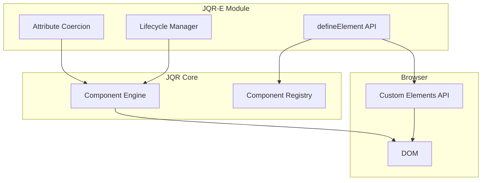

<!-- {
  "path": "jqr-e",
  "name": "docs-jqr-e-index",
  "meta": {
    "title": "Introduction",
    "order": 1
  }
} -->

# JQR-E: Custom Elements

JQR-E is an optional module that transforms JQR components into native **Custom Elements**, allowing you to use JQR components as real HTML tags.

## What is JQR-E?

JQR-E (`@en32/jqr/element`) bridges JQR's component system with the browser's native Custom Elements API. Instead of writing:

```html
<div $:component="my-button"></div>
```

You can write:

```html
<my-button></my-button>
```

This works for both **template-based** (core) and **render-based** (`jqr-h`) components.

## Key Features

### 🎯 **Native HTML Tags**
Transform any JQR component into a standard custom element that works like native HTML.

### 🔄 **Dual Ownership Mode**
- **Inside JQR components**: Owned by parent, full reactive binding (`$:prop:*`, `$:on:*`, `$:model:*`)
- **Standalone HTML**: Self-managed lifecycle, works with vanilla JavaScript or any framework

### ⚡ **Zero Breaking Changes**
Completely optional module. Existing code using `$:component` and `h('name')` continues to work unchanged.

### 🧩 **Framework Agnostic**
Use JQR components in plain HTML, React, Vue, or any other framework via standard DOM APIs.

### 🎨 **Full Feature Support**
- Props (with automatic type coercion)
- Events (native CustomEvent dispatch)
- Slots (including named and scoped slots)
- Two-way binding with `$:model`
- All lifecycle hooks

## When to Use JQR-E

**Use Custom Elements when:**
- ✅ Building reusable component libraries
- ✅ Integrating JQR with other frameworks
- ✅ You want semantic, self-documenting HTML
- ✅ Using components in plain HTML without initialization code
- ✅ You need standard DOM APIs (`addEventListener`, `querySelector`, etc.)

**Stick with `$:component` when:**
- ⚠️ Building simple, internal-only components
- ⚠️ You don't need interoperability with other frameworks
- ⚠️ Component is only used within JQR scope
- ⚠️ You want to minimize bundle size

## Quick Example

### Defining a Custom Element

```html
<script src="https://cdn.jsdelivr.net/npm/@en32/jqr@latest/dist/jqr.min.js"></script>
<script src="https://cdn.jsdelivr.net/npm/@en32/jqr@latest/dist/jqr.e.min.js"></script>

<script>
  // Define component
  JQRE.defineElement('user-card', {
    props: {
      name: '',
      avatar: ''
    },
    template: `
      <div class="card">
        
        <h3 $:text="name"></h3>
        <slot></slot>
      </div>
    `
  });
</script>
```

### Using the Custom Element

```html
<!-- Standalone: works in plain HTML -->
<user-card name="John Doe" avatar="/avatar.jpg">
  <p>Software Engineer</p>
</user-card>

<script>
  const card = document.querySelector('user-card');
  
  // Wait for component to mount
  await card.$mounted;
  
  // Access props
  console.log(card.name); // "John Doe"
  
  // Change props
  card.name = "Jane Smith";
</script>
```

```html
<!-- Inside JQR component: reactive bindings -->
<div $:component:state="{ user: { name: 'Alice', avatar: '/alice.jpg' } }">
  <user-card 
    $:prop:name="user.name" 
    $:prop:avatar="user.avatar">
    <p>Administrator</p>
  </user-card>
</div>
```

## How It Works

### Two Operating Modes

JQR-E implements **dual ownership**:

#### 1. Parent-Owned Mode
When a custom element appears inside a JQR component:
- Mounted synchronously by the parent
- Props bound via `$:prop:*`, `$:model:*`
- Events handled via `$:on:*`
- Full reactive integration

#### 2. Standalone Mode
When a custom element appears in plain HTML:
- Auto-mounts after `DOMContentLoaded`
- Props set via HTML attributes or JavaScript properties
- Events dispatched as native `CustomEvent`
- Self-manages lifecycle

The same component definition works in both modes using the same internal engine.

## Architecture



## Compatibility

- **Browsers**: All modern browsers supporting Custom Elements v1 (Chrome, Firefox, Safari, Edge)
- **jQuery**: Works with full jQuery or JQR's built-in minimal fallback
- **JQR Core**: Requires `@en32/jqr` v0.1.0 or later
- **JQR-H**: Optional, only needed for render-based components

## Module Structure

```
@en32/jqr/element
├── defineElement()       # Define single custom element
├── defineElements()      # Define multiple elements
├── defineRegistered()    # Auto-define all registered components
├── isJqrElement()        # Type guard
└── getInstance()         # Get component instance from element
```

## Bundle Options

**Browser (IIFE):**
```html
<!-- Separate files -->
<script src="/jqr.core.js"></script>
<script src="/jqr.h.js"></script>   <!-- optional -->
<script src="/jqr.e.js"></script>   <!-- NEW -->

<!-- Or use all-in-one bundle -->
<script src="/jqr.all.js"></script> <!-- core + h + element -->
```

**ESM (Bundler):**
```js
import { defineElement } from '@en32/jqr/element';
```

## What's Next?

- **[Installation](./installation.md)** - Setup guide
- **[Defining Elements](./guides/defining-elements.md)** - Core API usage
- **[Attributes & Props](./guides/attributes-and-props.md)** - Type coercion and reflection
- **[Events](./guides/events.md)** - Native event dispatch
- **[Lifecycle](./guides/lifecycle.md)** - Mounting and ownership

## Limitations

- **No Shadow DOM**: JQR scans and manages slots in Light DOM
- **No Customized Built-ins**: No `<button is="my-button">` (Safari doesn't support)
- **State Reset on Disconnect**: Component state is lost if element stays detached longer than one microtask (configurable with `keepAlive` option - coming soon)
- **Late Parent Mount**: Parent components mounted imperatively after children may not claim ownership (see [Lifecycle guide](./guides/lifecycle.md))

## Experimental Status

⚠️ **JQR-E is currently experimental.** The API may change without notice. Use in production at your own risk.

No migration guides or changelogs are provided during the experimental phase. Documentation reflects the current API only.
